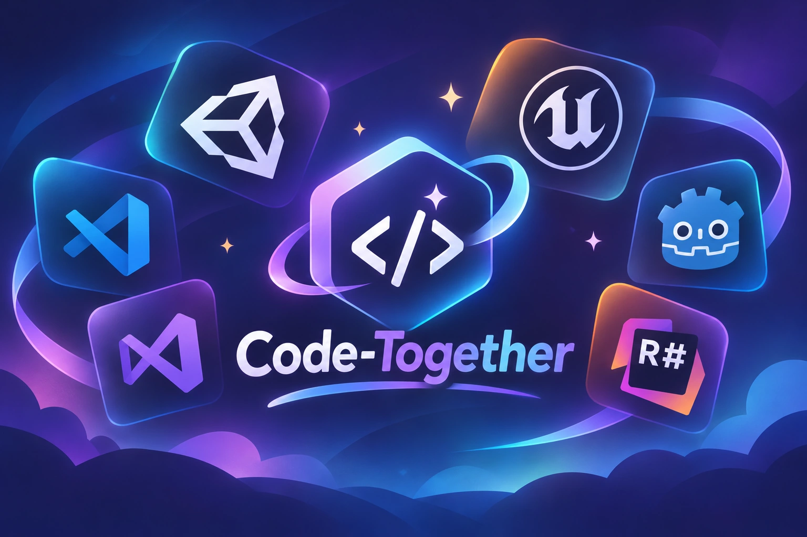
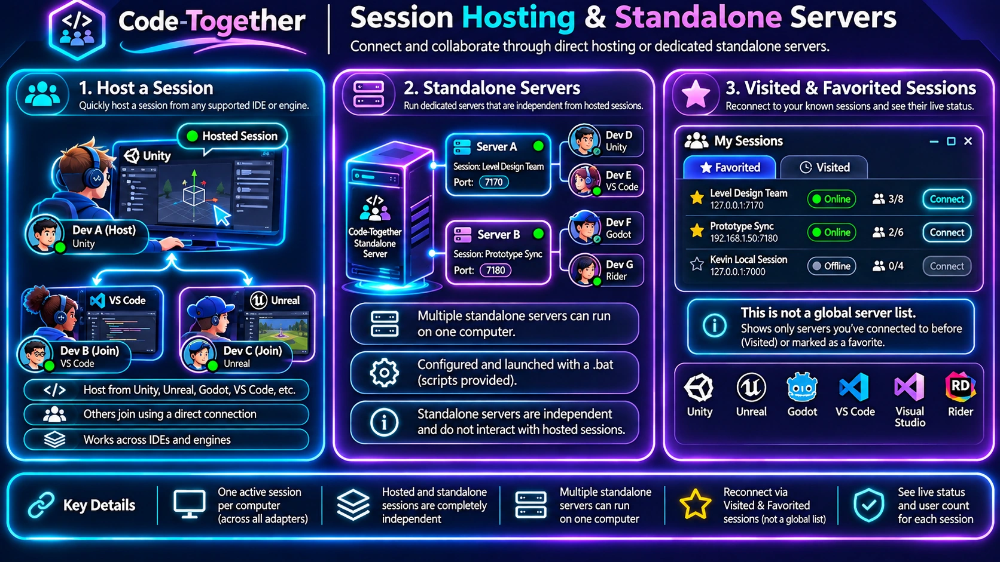
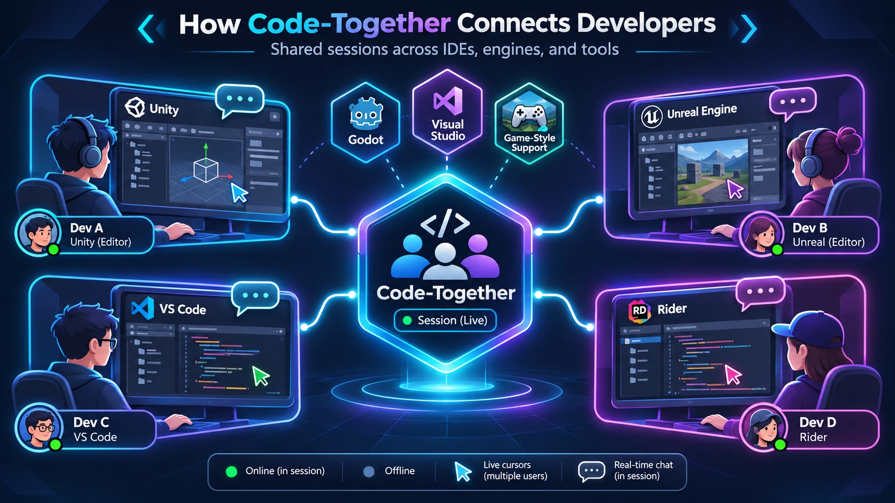
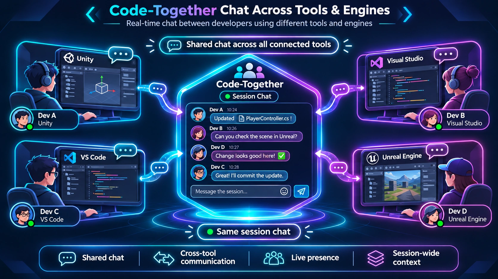
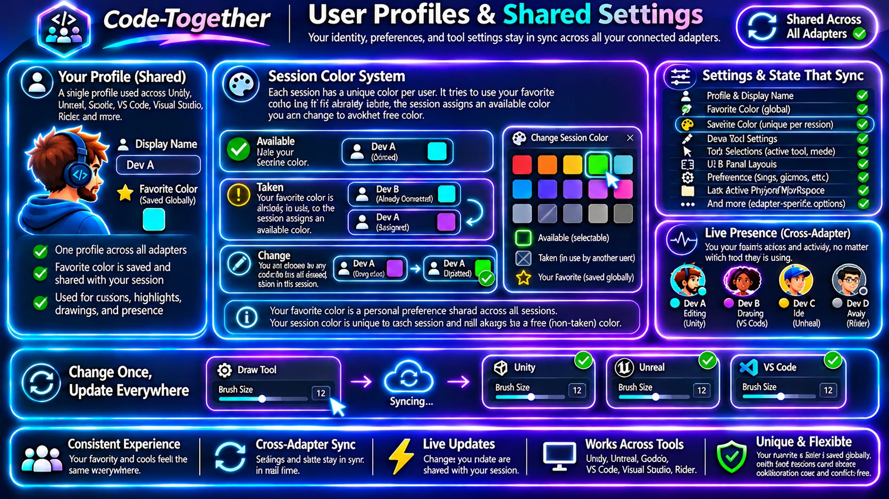
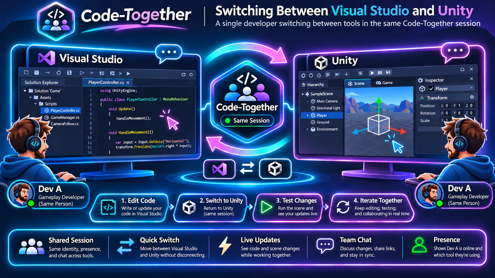
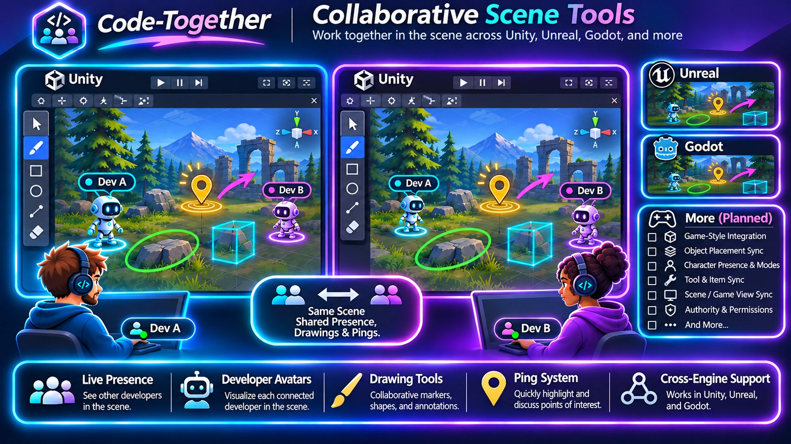
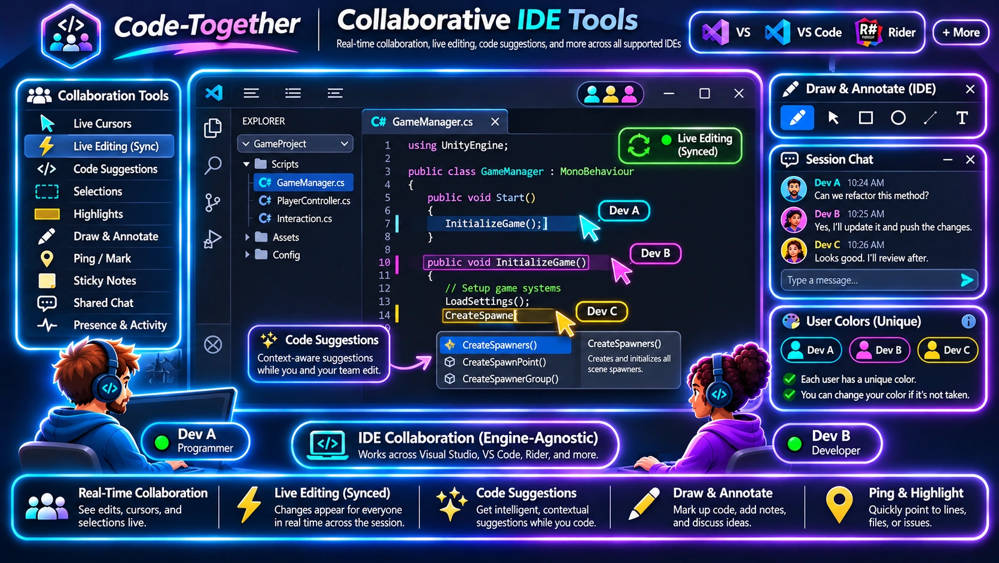

# Code Together

  

Code Together by Blue Team Games brings IDEs and game engines into a shared development session. Each developer chooses the tools they work in, while [Shared Perspective](https://github.com/KD-Kevin/Shared-Perspective) provides the common session for identity, presence, activity, and chat.

[Install an adapter](#install-an-adapter) · [Set up a session](#set-up-a-session) · [How collaboration works](#how-collaboration-works)

## Install an adapter

Choose the repository for your editor or IDE. The project is in development, with Windows as the initial target. The table describes the current development builds.

| Tool | Source and setup | Current development status |
| --- | --- | --- |
| Unity | [Unity adapter](https://github.com/KD-Kevin/code-together-Unity) | Editor package with local profile, scene drawing, and Windows host and join controls. |
| Unreal Engine | [Unreal adapter](https://github.com/KD-Kevin/code-together-Unreal) | Editor plugin with local profile and viewport drawing. Session integration is in development. |
| Godot | [Godot adapter](https://github.com/KD-Kevin/code-together-Godot) | Editor add-on with local profile and 3D drawing. Session integration is in development. |
| Visual Studio | [Visual Studio adapter](https://github.com/KD-Kevin/code-together-VisualStudio) | Planned extension. The repository is the project home for future builds. |
| VS Code | [VS Code adapter](https://github.com/KD-Kevin/code-together-VSCode) | Extension scaffold that can run in an Extension Development Host. Collaboration features are in development. |
| Rider | [Rider adapter](https://github.com/KD-Kevin/code-together-Rider) | Planned plugin. The repository is the project home for future builds. |

Install [Node.js](https://nodejs.org/) and follow the Windows setup in [Shared Perspective](https://github.com/KD-Kevin/Shared-Perspective) for multiplayer. In Unity, open the adapter's **Connection** tab and use **Locate Shared Perspective** if the runtime setup warning appears.

## Set up a session

| Mode | How it starts | How developers join |
| --- | --- | --- |
| **Hosted session** | In an adapter with hosting support, open **Connection**, enter a name, port, and optional password, then choose **Host Session**. Use **Local Servers** to check its status or stop it. | Share the host's address and port. Enter those details and the password, if configured, in the adapter's join form. |
| **Standalone server** | Run Shared Perspective's `start-standalone.bat` for prompts, use `start-standalone.example.bat` as a template, or launch from the terminal. Each standalone instance runs separately. Several can run on one machine alongside a hosted session, each on its own port. | Join by the server's address and port. The standalone server keeps running until its process stops. |

To join from another machine for the first time, enter the server's address and port. The session browser is designed around **Recently Visited** and **Favorites**, with live availability and participant counts for saved servers. After one supported app connects, other supported apps under the same Windows account can use **Join Current Session**. **Leave Session** disconnects the local apps from that session.

View the hosting and server browser diagram

## How collaboration works

Shared Perspective provides the server and local coordinator. A developer can connect from several apps and appear as one participant, with each app retaining its own connection and activity. This lets someone switch from a script in an IDE to a scene in an engine while staying in the same conversation.

The artwork illustrates the intended workflow. Feature availability follows the adapter status above.

### Chat, presence, and profiles

Shared Perspective supports session-wide chat, presence, and activity. The adapter design brings that conversation and roster into each connected tool, so teammates can follow who is online and which app they are using.

The Unity, Unreal, and Godot adapters share a local display name and favorite color under the same Windows account. The favorite color is a saved preference. The planned session-color workflow uses it when available, assigns a different color when it is taken, and lets the participant pick another available color.

View the chat, profile, and editor-switching diagrams

### Scene and code collaboration

The engine adapters include viewport guides such as lines, freehand strokes, splines, ovals, and rectangles. The erase brush cuts covered portions of your own guides. Shared scene annotations, pings, and developer avatars in the editor viewport are part of the multiplayer design.

The IDE design includes live cursors and selections, following a teammate's view, and whiteboard annotations. Workspace-specific events use grants scoped to the project and the adapter's capability. For example, Unity scene events stay within the authorized Unity workspace while session chat remains available to joined clients across tools.

View the scene and IDE collaboration diagrams

### Optional AI teammate

A future Code Together feature would let an AI teammate join as a distinct participant with its own chat identity and presence. The planned modes are Off, On Request, Selective, and Active. Selective mode uses local event filtering to limit model calls. Permissions and usage budgets control what the teammate can access and how often it can run.

---

*Game-Style Multiplayer is a separate, upcoming extension for the Game-Style Editor, planned for the Unity Asset Store. It will use Shared Perspective to join the same sessions and will be distributed through the store.*
